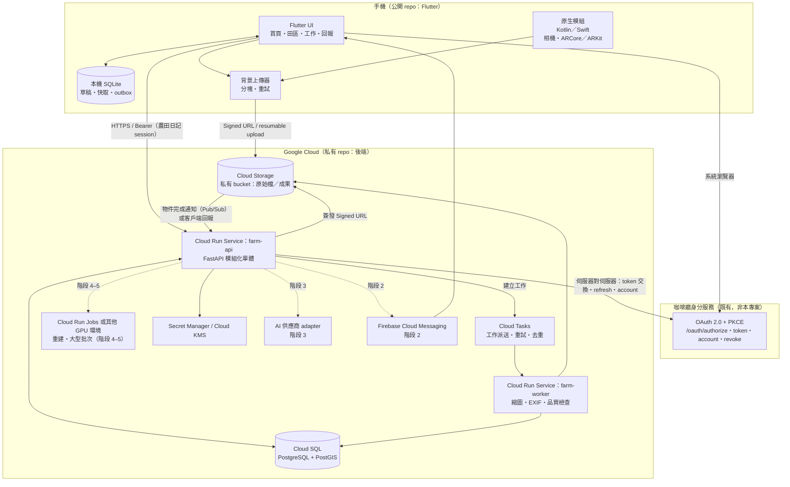
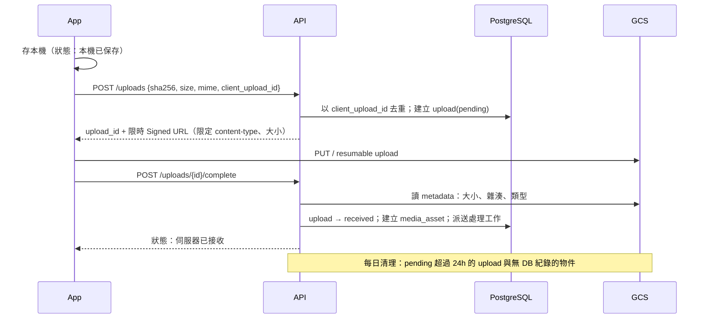

# 農田日記 — 系統架構（ARCHITECTURE）

> 狀態：設計草案，尚未實作或部署。所有雲端服務能力與價格在採用前須依當日官方文件查證（見 PROJECT_BRIEF V5、V6、V8）。
> 最後更新：2026-10-20

## 1. 設計原則

- 一個分層清楚的主要 API（模組化單體），不在第一版拆微服務。
- 一套正式資料來源（PostgreSQL）。大型檔案在 Cloud Storage，資料庫只存索引、權限、來源、版本、狀態。
- 重運算交給獨立處理器，透過工作佇列派送；HTTP 請求不等待長工作。
- 權限一律由後端強制執行；前端隱藏只是體驗，不是安全。
- 任何外部服務（地圖、AI、天氣、身分）都隔在 adapter 後面，資料不綁供應商。

## 2. 資料庫選型：Firestore vs. PostgreSQL／PostGIS

| 面向 | A：Firestore + Firebase | B：Cloud SQL PostgreSQL + PostGIS | 對本產品的權重 |
| --- | --- | --- | --- |
| 複雜關聯（田區↔地號多對多、期作↔種植區↔紀錄↔資材↔成本） | 需反正規化與手動維護副本；沒有外鍵 | 外鍵、唯一約束、檢查約束原生支援 | **高** |
| 地理查詢（面積、交集、點在面內、邊界版本） | 只有 geohash 範圍查詢，面積與交集需自算 | PostGIS `ST_Area`（geography 或投影座標）、`ST_Intersects`、GiST 索引 | **高** |
| 成本、庫存、工資一致性 | 有 transaction，但跨集合查詢與彙總受限，報表需另建彙總 | ACID 交易、`SELECT … FOR UPDATE`、SQL 彙總 | **高** |
| 多租戶隔離 | Security Rules（但我們的 App 不直接讀資料庫，價值有限） | 每表 `workspace_id` + 應用層強制；可加 Row-Level Security 作第二道防線 | 高 |
| 離線與同步 | 官方 SDK 內建離線快取（最大優勢） | 需自建：本機 SQLite + outbox + 同步 API | 中（自建可控制衝突語意，反而是財務／庫存需要的） |
| 開發成本 | 前期快；報表與關聯變多後成本上升 | 前期需 schema 與 migration；後期穩定 | 中 |
| 初期閒置成本 | 依讀寫計費，閒置接近 0 | 執行中的執行個體持續計費（無自動 scale-to-zero，可手動停止）；dev 可用本機 Docker | 中 |
| 查詢與索引 | 複合索引需預先宣告；不支援任意 join、聚合有限 | 任意 SQL、部分索引、全文檢索 | 高 |
| 備份還原 | 排程匯出／PITR（需查證當前功能） | 自動備份 + PITR；可 `pg_dump` 匯出到任何地方 | 中 |
| 遷移與可攜性 | 鎖定 Firestore 資料模型 | 標準 PostgreSQL，可搬到任何供應商 | 中 |
| 維運負擔 | 很低 | 低到中（Cloud SQL 代管；需規劃規格、連線數、維護時段） | 中 |

**推薦：方案 B（Cloud SQL for PostgreSQL + PostGIS）為唯一正式資料來源。**

理由：本產品最核心的價值是「可追溯、可對帳的關聯資料」與「田區空間資料」，這兩項正是 Firestore 最弱、PostgreSQL／PostGIS 最強的地方。Firestore 的離線優勢對我們打折扣，因為財務、庫存、派工本來就不能用「最後寫入者勝出」，仍需自訂同步語意。

Firebase 仍採用的部分（不存正式業務資料）：

- Firebase Cloud Messaging：推播（階段 2）。
- Firebase Crashlytics／App Distribution：可選，需在隱私說明揭露。
- Firebase App Check：可選，作為濫用防護的一層，不取代後端授權。
- **不採用** Firebase Authentication 作為主要身分（理由見 AUTH_INTEGRATION §6）。

不建立兩套正式資料來源。若未來需要 Firestore 做即時通知 fan-out，僅存可重建的衍生資料。

## 3. 系統架構



### 3.1 後端分層（farm-api）

```
api/        路由、request/response schema、錯誤格式；不含業務規則
auth/       session 驗證、上游 OAuth adapter、dev 測試身分（僅 local）
authz/      角色 × 動作 × 欄位群組的政策判斷（唯一的授權決策點）
domain/     實體、值物件、狀態機、業務規則（純 Python，可單元測試）
services/   用例：建立工作、確認紀錄、上傳完成……（交易邊界在這層）
repo/       SQLAlchemy 存取；所有查詢強制帶 workspace_id
adapters/   GCS、Cloud Tasks、OAuth、Maps、AI、天氣
jobs/       worker 端處理器（冪等）
```

## 4. 公開前端與私有後端邊界

| 放公開 Flutter repo | 放私有後端 repo | 兩邊都不放（Secret Manager／CI secret） |
| --- | --- | --- |
| UI、本機資料層、同步客戶端、原生採集模組 | API、schema、migration、授權政策、處理器、AI 工具、部署設定 | 資料庫密碼、OAuth 上游 refresh token 加密金鑰、session 簽章金鑰、AI API key、Android 簽署 keystore、Apple 憑證 |
| API 契約的「產生後」客戶端（OpenAPI → Dart）| OpenAPI 原始定義 | 正式 OAuth client 設定以外的任何秘密 |
| 可公開設定：OAuth client_id、callback、API base URL、Google Maps API key（**需在 GCP 限制 Android 套件名稱＋SHA-1 與 iOS Bundle ID**）、Firebase 設定檔 | 正式網域、GCP 專案 ID 的對應表 | 真實個資、真實農場座標 |
| 測試用假資料（明確虛構） | 匿名化測試資料產生器 | — |

原則：「可公開」不等於「不需限制」。Maps key 與 Firebase 設定可以出現在 App 內，但必須設定 API 限制與配額，並由後端做真正的授權。

## 5. 雲端工作排程與同步回饋

### 5.1 派送選擇

| 工作類型 | 例子 | 派送 | 執行 |
| --- | --- | --- | --- |
| 短（< 1 分鐘）、逐筆 | 縮圖、EXIF 解析、雜湊、病毒／格式檢查 | Cloud Tasks（每個任務有名稱可去重、可設重試上限與退避） | farm-worker（Cloud Run Service，與 API 分開擴展與權限） |
| 中（數分鐘）、逐工作階段 | 巡田影格品質檢查、覆蓋判斷 | Cloud Tasks | farm-worker（設請求逾時上限；超過拆段） |
| 長、批次、可能需 GPU | 三維重建、大量重算 | API 建立 `processing_job` 後觸發 Cloud Run Job 執行（或其他 GPU 環境，待查證） | 單一 job 有逾時、並行上限與每工作空間配額 |
| 定時 | 孤立檔案清理、到期提醒、備份檢查 | Cloud Scheduler | farm-worker 端點（OIDC 驗證呼叫者） |

不採用 Pub/Sub 作為主要工作派送：我們需要的是「每件工作一個任務、可去重、可設重試」，Cloud Tasks 的語意較直接。Pub/Sub 只用於接收 GCS 物件事件（若採用）。

### 5.2 工作生命週期（資料表 `processing_job`）

`queued → running → succeeded | partially_succeeded | failed | cancelled`，另有 `retry_scheduled`。

欄位：`id`、`workspace_id`、`kind`、`priority`、`dedup_key`（唯一）、`input_refs`、`params_version`、`attempt`、`max_attempts`、`lease_until`、`progress`（0–100 + 階段文字）、`partial_outputs`、`error_code`、`cost_estimate`、`requested_by`、時間戳。

- **冪等**：worker 以 `UPDATE … SET status='running', lease_until=… WHERE id=… AND (status='queued' OR lease_until < now())` 取得租約；拿不到就直接結束。輸出以 `(job_id, output_kind, version)` 唯一，重跑不產生重複。
- **重試**：只對可重試錯誤（網路、暫時性 5xx）；格式錯誤直接 `failed`。上限與退避同時設在 Cloud Tasks 與資料表。
- **取消**：設 `cancel_requested`，worker 在每個檢查點讀取並停止。
- **預算**：建立 job 前檢查工作空間當月配額（張數、GPU 分鐘、AI token），超過則 `rejected_quota`，不排隊。

### 5.3 即時回饋

1. 主要：客戶端查詢 `GET /jobs/{id}`、`GET /capture-sessions/{id}/status`（狀態以資料庫為準，斷線後重查即可得正確狀態）。
2. 加速：Server-Sent Events（`GET /events?since=cursor`）推送狀態變更；API 從 `domain_event` 表依 cursor 讀取，不依賴單一執行個體記憶體。Cloud Run 對長連線有請求逾時，客戶端需自動重連並帶 cursor。
3. App 在背景：FCM 通知「需要補拍」「成果可用」（階段 2 以後）。

不使用 WebSocket 作為第一版方案：SSE 單向即足夠，且在 Cloud Run 上較單純。

## 6. 上傳工作階段（跨 DB 與物件儲存的一致性）



- 物件路徑 `ws/{workspace_id}/media/{upload_id}`，不含檔名或個資。
- bucket 不公開；讀取一律由 API 檢查權限後簽發短效 URL（建議 5–15 分鐘）。
- 驗證：大小上限、允許的 MIME、伺服器端嗅探 magic bytes、雜湊比對。

## 7. 離線與同步

### 7.1 本機狀態（UI 必須分開顯示，不共用一個勾號）

| 狀態 | 圖示＋文字 |
| --- | --- |
| 本機已保存 | 手機圖示「已存在手機」 |
| 同步中 | 轉圈「上傳中」 |
| 已同步 | 雲朵勾「已上傳」 |
| 同步失敗（可重試） | 驚嘆號「上傳失敗，會自動重試」+ 立即重試按鈕 |
| 衝突待處理 | 雙箭頭「內容和雲端不同，請選擇」 |
| 被拒絕（權限變更） | 鎖頭「你已無權修改，內容已保留在手機」+ 匯出／複製 |

### 7.2 同步協定

- 所有實體 ID 由客戶端產生（UUIDv7），離線建立的資料也有穩定 ID。
- 每個寫入是一筆 outbox 命令：`{command_id, entity, op, payload, base_version}`；`command_id` 作冪等鍵，重送不重複。
- 伺服器每筆資料有 `version`（整數遞增）。`base_version` 不符 → 依資料類型處理：

| 資料類型 | 衝突策略 |
| --- | --- |
| 描述性欄位（田區名稱、備註） | 欄位層級合併；同欄位衝突 → 交給使用者選 |
| 回報、照片、語音、巡田觀察 | **只新增不覆蓋**，不會衝突 |
| 庫存異動、付款、工時 | 記帳式（ledger）新增，不改餘額；餘額由異動加總，離線新增不衝突。修正以「沖銷＋新增」完成 |
| 狀態轉移（工作完成、紀錄確認） | 伺服器依狀態機驗證；不合法轉移拒絕並回傳目前狀態 |
| 人員安排回覆 | 以時間戳記保留每次回覆歷程，目前狀態取最新「已確認」事件 |

- 拉取：`GET /sync/changes?cursor=` 回傳該使用者有權看到的變更；權限被撤銷時回傳 `revoked` 清單，App 清除對應本機快取（未上傳的草稿保留並提示）。
- 被移除成員：伺服器拒絕其所有寫入（403 + `membership_revoked`）；App 鎖定該工作空間，只保留使用者自己建立、未上傳的草稿供匯出。
- 高敏感操作（付款標記、刪除、成員管理）：不進離線 outbox，必須連線並在 5 分鐘內登入過或重新驗證。

## 8. 地圖與空間資料

- 儲存：PostGIS `geometry(…, 4326)`；面積以 `ST_Area(geom::geography)` 或轉 EPSG:3826 計算，記錄 `area_method`。
- GeoJSON 為交換格式，座標順序固定 `[經度, 緯度]`；API 層有測試防止順序顛倒。
- 區分資料表：`field_boundary_version`（管理邊界）、`track`（軌跡）、`geofence`（背景圍欄）、`media_footprint`（影像觀察範圍）、`cadastral_ref`（地籍參考，只存地號與來源，不宣稱精確界線）。
- 地圖供應商只負責顯示；任何幾何都由我們的資料表產生。

## 9. 環境

| 環境 | 資料庫 | 身分 | 用途 |
| --- | --- | --- | --- |
| local | Docker PostGIS | dev 測試身分（只在 local 啟用） | 開發、單元與整合測試 |
| staging | 獨立 GCP 專案、獨立 Cloud SQL | 咖啡廳 staging（若有）或 dev 身分（明確標示） | 端到端驗收、TestFlight、內測 APK |
| production | 獨立 GCP 專案 | 咖啡廳正式 OAuth | 正式使用 |

三個環境使用不同 GCP 專案、不同服務帳號與 bucket；測試設定檔若指向 production 專案，啟動即失敗。
