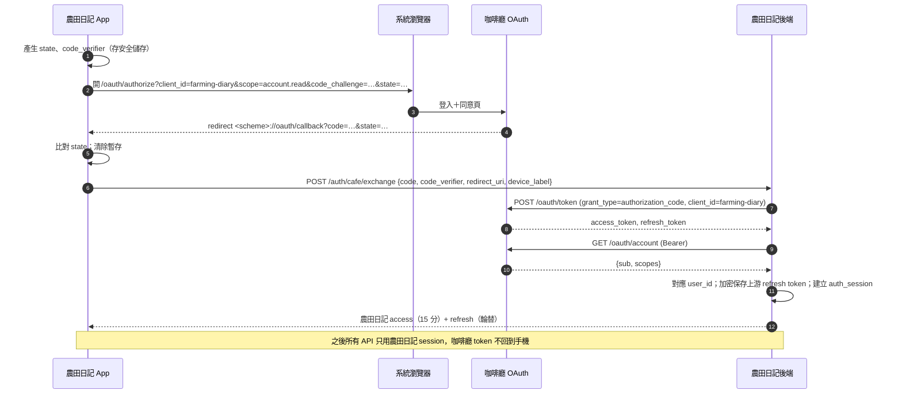

# 農田日記 — 咖啡廳 OAuth 整合（AUTH_INTEGRATION）

> 狀態：分析完成、設計草案。**咖啡廳端未做任何修改；農田日記尚未串接正式 OAuth。**
> 最後更新：2026-10-20

## 1. 檢查來源與證據

| 項目 | 值 |
| --- | --- |
| Repository | `shenlee377/chat-coffee-bot-python`（公開可讀） |
| Branch | `v5-Google-Cloud-Run`（以 `git clone --branch v5-Google-Cloud-Run --single-branch` 取得，未使用預設分支） |
| Commit SHA（完整閱讀） | `da37c93de9630d14831d320c272207da45e4c96b` |
| Commit 時間／訊息 | 2026-10-19 18:28 +0800「記帳簿經 OAuth 使用咖啡廳 AI：Bearer 版 Apple 路由與有效 AI 偏好」 |
| 複核時分支最新 SHA | `35dbe966549a376fd41f5fa624810f2010305d7b`（2026-10-20 11:06 +0800「記帳簿委外整理對帳單：/v1/apple/statement 與 read_statement 開關」） |
| 兩者差異 | 只新增 `ai.tools` 範圍的 `/ai/assistant/v1/apple/statement` 與 `docs/IOS_OAUTH.md` 一行說明；`backend/oauth_clients.py`、`backend/oauth_grants.py`、`web/auth/oauth_native.py`、`web/routes/account/oauth_native.py`、`tests/test_oauth_native.py` **無變更**，下列結論仍適用 |
| 檢查日期 | 2026-10-20 |

已閱讀的檔案：

- `docs/IOS_OAUTH.md`
- `backend/oauth_clients.py`（可信註冊表）
- `backend/oauth_grants.py`（授權、session、token 儲存與輪替）
- `web/auth/oauth_native.py`（PKCE、redirect 驗證、pairwise sub、access token 載入）
- `web/routes/account/oauth_native.py`（`/oauth/token`、`/oauth/account`、metadata 等路由）
- `backend/identity/session_sync.py` 中的 `credential_still_valid`、`current_epoch`
- `tests/test_oauth_native.py`（只看測試清單，**未執行**）

未能驗證：

- **部署狀態**：`docs/IOS_OAUTH.md` 第一行仍寫「2026-10-14 重構；尚未部署」。repo 內沒有可證明已部署的紀錄。正式環境是否運行此版本 → 未驗證。
- **測試結果**：未在咖啡廳環境執行 pytest → 未驗證。
- **正式網域**：authorization server origin 由 `FLASK_API_ORIGIN` 設定，repo 中沒有正式值 → 未知。舊 `Farming-Diary/backend/app/core/config.py` 裡的 `https://api.coffeeshop.tw/oauth/verify` **不存在於咖啡廳程式碼，是虛構的端點**；該檔已隨 `backend/` 刪除（D-010），新後端不得沿用。

## 2. 已由程式碼驗證的事實

| 主題 | 實作事實 | 位置 |
| --- | --- | --- |
| 協定 | OAuth 2.0 Authorization Code + PKCE，只接受 `S256`，verifier 43–128 字元 | `verify_pkce` |
| 不是 OIDC | 沒有 ID Token、沒有 OIDC discovery；有 RFC 8414 風格的 `/.well-known/oauth-authorization-server` | `metadata()` |
| Client 驗證 | public client，`token_endpoint_auth_methods_supported: ["none"]`；client 必須在註冊表 | `/oauth/token` |
| Redirect | 精確比對註冊表；`http://127.0.0.1|localhost` loopback 允許任意 1024–65535 埠 | `validate_redirect_uri` |
| Token 格式 | **不透明字串**（`secrets.token_urlsafe(48)`），伺服器只存 SHA-256 摘要；**不是 JWT** | `oauth_grants.py` |
| TTL | access 900 秒；裝置 session／refresh 最長 30 天 | `ACCESS_TTL`、`REFRESH_TTL` |
| Refresh | 每次輪替；舊 refresh 重播 → 停用**該裝置** session 並記事件 | `refresh()` |
| Refresh 綁 client | `session['client_id'] != client_id` 即拒絕 | `refresh()` |
| 驗證介面 | 沒有 introspection 端點；資源伺服器以 Bearer 呼叫 `GET /oauth/account` 取得資料 | `account_info()` |
| `account.read` 回傳 | `{"sub": pairwise, "scopes": [...]}`，另依 scope 加 name／email／phone／discord | `account_info()` |
| Pairwise sub | `HMAC-SHA256(SECRET_KEY, "oauth-sub:" + client_id + ":" + account)` → 不同 client 的 sub 必不同 | `public_subject` |
| 撤銷／停權 | 每次使用 access token 時檢查 grant 與 session 是否 active，並檢查帳號 epoch（改密碼、封鎖會使 epoch 改變） | `access()`、`credential_still_valid` |
| 撤銷 API | `POST /oauth/revoke`；`{"scope":"all"}` 撤銷整個 App | 路由 |
| Scope 生效 | access token 的 scopes 每次由 grant 即時計算，移除權限立即生效 | `access()` |
| 速率限制 | `/oauth/token` 30 次／分鐘 | `@limiter.limit` |
| 註冊表現況 | `chatcoffee-ios`、`coffeeshoptw-salary`，另有文件未列的 `chatcoffee-ide` | `CLIENTS` |

與文件線索的差異：

1. `IOS_OAUTH.md` 的 client 表只列兩個 client，實作已有第三個 `chatcoffee-ide`。
2. `credential_still_valid` 在讀不到帳號狀態（資料庫暫時不可用）時**放行**（fail-open）。這是咖啡廳刻意的取捨，農田日記需知道：上游停權在咖啡廳資料庫故障時不會生效。
3. Pairwise sub 用 `SECRET_KEY` 計算。**若咖啡廳輪替 `SECRET_KEY`，所有 App 的 sub 都會改變**，農田日記會找不到既有使用者。

## 3. 農田日記 client 註冊草案

> 只是草案。不得使用 `chatcoffee-ios`、`coffeeshoptw-salary` 或 `chatcoffee-ide`。

```python
Client(
    client_id='farming-diary',            # 暫定，待 D-008 定案
    name='農田日記',
    description='家庭農場的田區、農事、派工與紀錄協作 App。',
    redirect_uris=(
        '<app-scheme>://oauth/callback',   # 例：tw.example.farmingdiary://oauth/callback，待網域與 ID 定案
        # 之後有自有網域時改用 https App Links／Universal Links：
        # 'https://<domain>/oauth/callback',
    ),
    required=('account.read',),
    optional=(),
    purposes={
        'account.read': '確認登入的是同一個咖啡廳帳號，讓你在不同手機登入時看到同一份農場資料。',
    },
    data_statement=(
        '農場、田區、農事、聯絡人與財務資料存放在農田日記自己的伺服器，不會傳給咖啡廳。',
        '咖啡廳只提供一個專屬於農田日記的匿名識別碼，不提供帳號名稱、Email 或電話。',
    ),
    never=('你的密碼', '兩步驟驗證碼', '電話號碼', 'Email', 'Discord 帳號',
           '咖啡廳會員與購買資料', '登入咖啡廳網站', '咖啡廳 AI 額度'),
    bundle_ids=(),          # 不使用咖啡廳 IAP
)
```

不會要求的 scope 與理由：

| Scope | 不要求的理由 |
| --- | --- |
| `profile` | 顯示名稱由使用者在農田日記自行輸入，可與咖啡廳帳號名稱不同 |
| `email` | 不以 email 合併帳號；邀請成員用邀請碼 |
| `phone` | 工作聯絡人的電話由管理者記錄在聯絡人資料，與登入者無關 |
| `discord.identity` | 與農務無關 |
| `site.session` | 不需要以使用者身分登入咖啡廳網站（高權限） |
| `membership.*`、`purchases.sync` | 不販售咖啡廳會員 |
| `ai.*` | 農田日記 AI 由自己的後端控制權限與成本；日後若要借用咖啡廳 AI，另案評估並以可選 scope 漸進授權 |
| `event.checkin` | 與農務無關 |

## 4. Android／iOS 共用或分開 client

| | 共用一個 client（推薦） | 各平台一個 client |
| --- | --- | --- |
| Pairwise sub | 兩平台相同 → 同一人自動對應同一 user | 不同 → 必須設計帳號連結流程 |
| 咖啡廳安全頁 | 顯示一個「農田日記」，下面列各裝置 | 顯示兩個 App，使用者容易困惑 |
| 撤銷 | 撤銷整個 App 會同時登出兩平台；單裝置登出仍可個別處理 | 可分平台撤銷 |
| Callback | 需兩平台都能接收同一 scheme（或兩個 redirect 都登記在同一 client） | 各自一個 |
| 風險 | Android 自訂 scheme 可能被其他 App 搶註；PKCE 確保搶到 code 也無法兌換 | 同左 |

**推薦共用 `farming-diary` 一個 client**。日後若需要平台差異（例如 iOS 用 Universal Link、Android 用 App Link），在同一 client 下登記兩個精確 redirect。

## 5. 使用者對應

```text
external_identity(
  provider  = 'cafe_oauth',
  issuer    = <咖啡廳 authorization server origin，正式／staging 分開>,
  client_id = 'farming-diary',
  subject   = <pairwise sub>,
  UNIQUE (provider, issuer, client_id, subject)
) → user_id（農田日記內部 UUID）
```

- 第一次登入：建立 `user` + `external_identity`。
- **不以 email、名稱或電話合併帳號**（我們本來就不取得這些資料）。
- 若日後出現第二個 client 或第二個身分提供者：在「已登入狀態」下，再用另一身分完成一次 OAuth，雙方都通過後才連結；連結與解除都寫稽核並通知。
- sub 改變（例如咖啡廳輪替 SECRET_KEY）時，使用者會像新帳號一樣登入；需靠上述連結流程或管理員協助恢復，不自動合併。

## 6. 信任邊界與 session 設計



為什麼由後端兌換 code：

1. 咖啡廳 `/oauth/account` 不回傳 token 是發給哪個 client。若讓 App 把咖啡廳 access token 交給後端驗證，後端無法確認它不是其他 App 的 token（混淆代理問題）。由後端自己以 `client_id=farming-diary` 兌換，token 來源就確定。
2. 咖啡廳 token 不存在手機，公開 App 原始碼外洩風險降低。
3. code 有 PKCE 保護，只有持有 verifier 的 App 能讓後端兌換成功。

避免繞過上游撤銷：

- 農田日記 access token 15 分鐘；refresh 時後端先以上游 refresh token 向咖啡廳 refresh（輪替）並呼叫 `/oauth/account`。上游失敗（撤銷、停權、改密碼、session 過期）→ 農田日記 session 立即失效。上游撤銷最慢在 15 分鐘內生效。
- 同一 `auth_session` 的上游 refresh 以資料庫列鎖序列化，避免兩個並行請求用同一個上游 refresh token 而觸發咖啡廳的「重播 → 登出裝置」。
- 農田日記 session 最長不超過上游 session（30 天）。
- 咖啡廳暫時無法連線：拒絕 refresh 並讓使用者保持本機唯讀與草稿（不能延長 session，否則等於繞過撤銷）。

Token 種類區分（不要混用）：

| 名稱 | 誰簽發 | 誰持有 | 用途 |
| --- | --- | --- | --- |
| 咖啡廳 authorization code | 咖啡廳 | 手機 → 後端，一次性 | 兌換 token |
| 咖啡廳 access／refresh token | 咖啡廳 | **只在農田日記後端**（refresh 加密存放） | 呼叫 `/oauth/account`、refresh |
| 農田日記 access／refresh token | 農田日記後端 | 手機安全儲存 | 呼叫農田日記 API |
| Firebase Custom Token／ID Token | — | — | **第一版不使用**。只有在 App 需要直接存取 Firebase 資源（例如 Firestore 即時監聽）時，才由後端以已驗證 user_id 簽 Custom Token 換取 Firebase ID Token；推播（FCM）不需要 Firebase Auth |

農田日記 token 也採不透明隨機字串，後端存 SHA-256 摘要；不使用 JWT，以便即時撤銷。

## 7. 行動端要求

- 使用系統瀏覽器（Android Custom Tabs、iOS `ASWebAuthenticationSession`），不用 WebView。Flutter 套件候選：`flutter_appauth`、`flutter_web_auth_2`（V5：維護狀態與授權待查證）。
- `state` 與 `code_verifier` 每次新產生，存在安全儲存（iOS Keychain、Android Keystore 支援的儲存），完成或取消後清除。
- callback 驗證：scheme／host／path 完全相符、`state` 相符、只處理一次。
- 取消、拒絕（`error=access_denied`）、逾時（建議 10 分鐘）各有清楚訊息，留在登入頁可重試。
- App 被系統終止後由 callback 冷啟動：從安全儲存讀回進行中的授權；找不到就要求重來，不接受孤兒 code。
- 登出：呼叫 `POST /auth/logout`，後端撤銷農田日記 session 並呼叫咖啡廳 `/oauth/revoke`（本裝置）。「登出所有裝置」另設確認。
- 刪除農田日記帳號：不刪除咖啡廳帳號；後端呼叫咖啡廳 `/oauth/revoke` `{"scope":"all"}` 撤銷農田日記授權（需使用者確認）。
- callback URL 只帶短效 code，不帶任何長效憑證。
- 公開 repo 只有 `client_id` 與 redirect URI，沒有 secret（public client 本來就沒有）。

## 8. 對咖啡廳服務的最小修改提案（未執行，需你確認）

| # | 修改 | 必要性 | 影響 |
| --- | --- | --- | --- |
| C1 | 在 `backend/oauth_clients.py` 新增 `farming-diary` client（§3） | **必要** | 只新增資料；同意頁與安全頁自動顯示 |
| C2 | `GET /oauth/account` 回應加上 `client_id` | 建議（縱深防禦） | 只加欄位，不破壞既有 App |
| C3 | Pairwise sub 改用獨立金鑰（例如 `OAUTH_PAIRWISE_SECRET`，預設沿用 `SECRET_KEY` 的值） | 建議 | 讓 `SECRET_KEY` 可輪替而不改變所有 App 的 sub；需小心遷移，預設值必須等於現值 |
| C4 | 提供 staging 環境與 staging 用 client 註冊 | 建議 | 讓農田日記不必以正式環境測試 |

咖啡廳正式環境的部署與設定變更，必須由你確認後另行進行。農田日記後端**不讀寫**咖啡廳 Firestore 的任何 OAuth 集合。

## 9. 開發環境隔離測試身分

在正式 OAuth 可用之前：

- 後端 `ENVIRONMENT=local` 且 `DEV_AUTH_ENABLED=true` 時才註冊 `POST /dev/auth/login {"dev_user": "alice"}`；其他環境該路由不存在（不只是回 403）。
- 發出的 token 與正式 token 同格式，但 `external_identity.provider='dev'`、`issuer='local-dev'`，不可能與正式身分撞號。
- 啟動檢查：`ENVIRONMENT in ('staging','production')` 且 `DEV_AUTH_ENABLED=true` → 程式拒絕啟動。
- 測試：`test_dev_auth_absent_in_production`。
- 所有文件、UI 在 dev 身分登入時顯示「開發測試身分」標籤。**不得據此宣稱正式 OAuth 已串接。**

## 10. 待你確認

1. C1–C4 是否同意、由誰修改與部署咖啡廳 repo。
2. v5 OAuth 實際部署時程與 authorization server origin（正式／staging）。
3. 咖啡廳 `SECRET_KEY` 的輪替政策。
