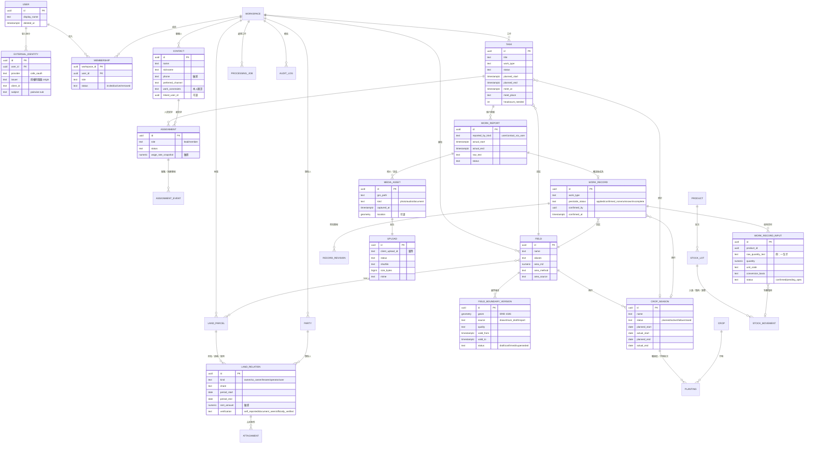
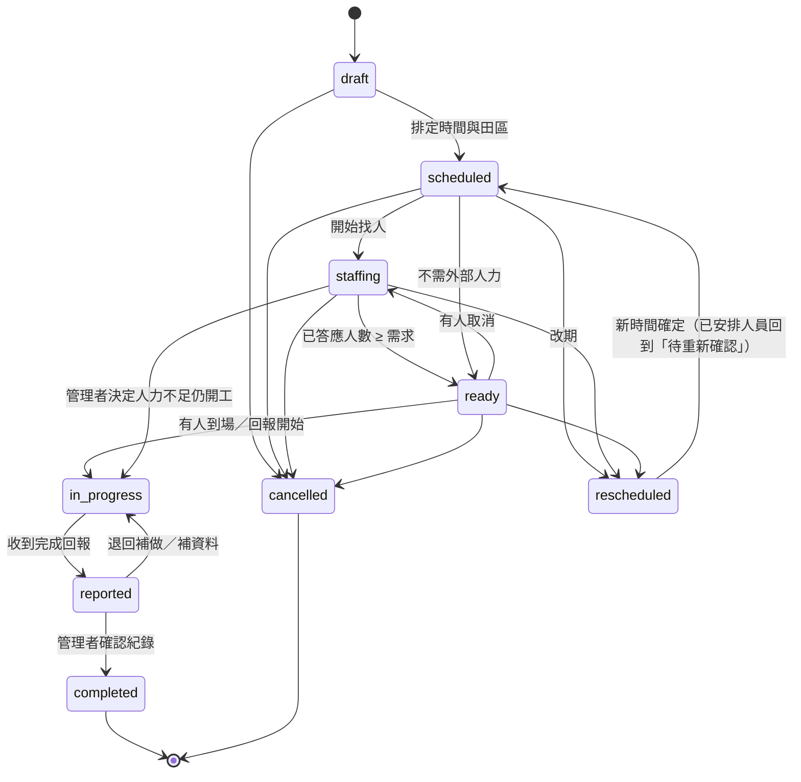
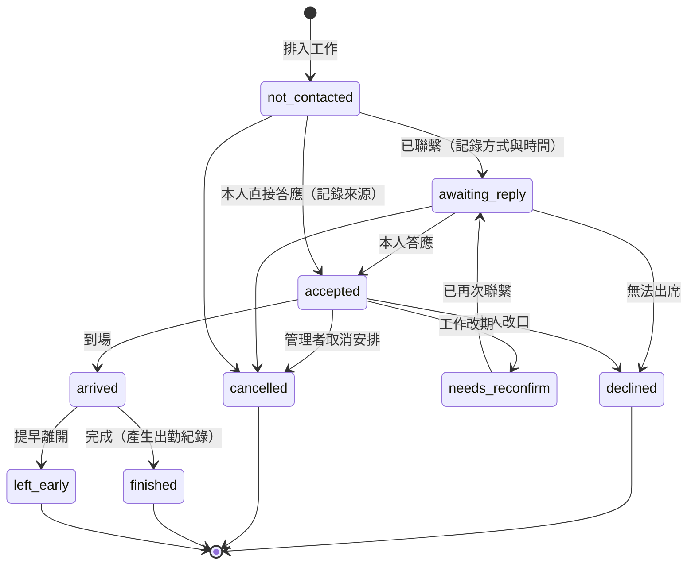
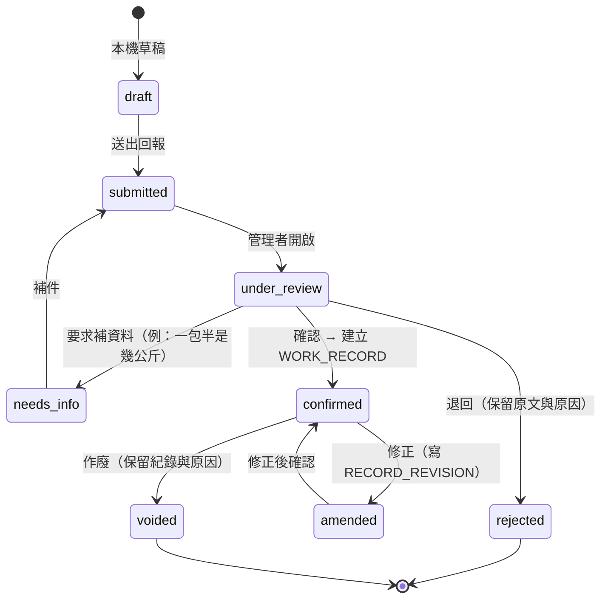
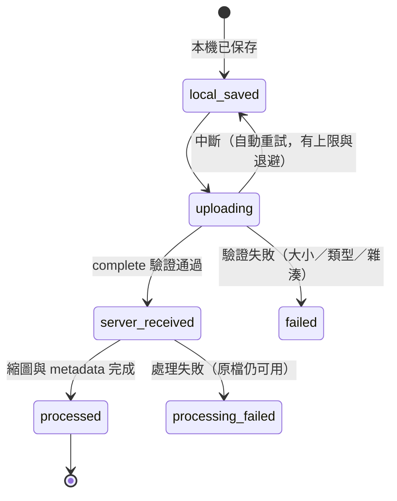
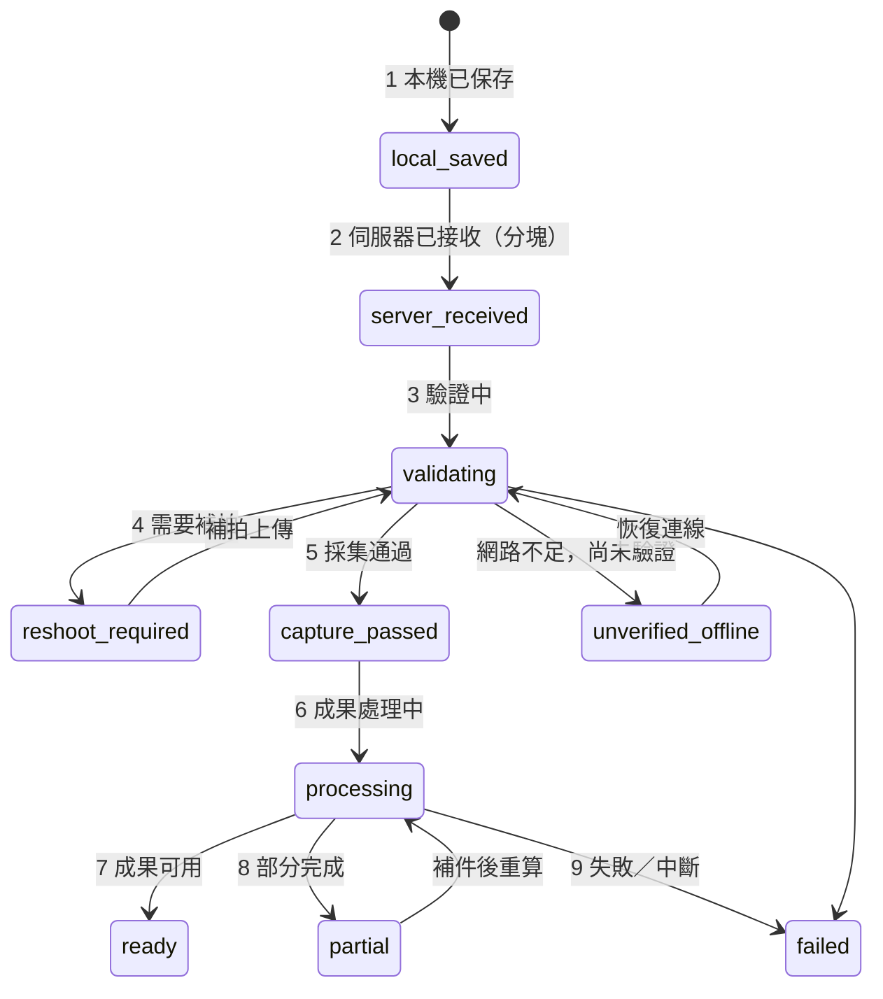

# 農田日記 — 領域模型與狀態機（DOMAIN_MODEL）

> 狀態：設計草案。M1 只實作標示 ★ 的實體；其他實體先定名稱與關係，避免日後大改。
> 最後更新：2026-10-20

## 1. 共通欄位與規則

所有業務表都有：

| 欄位 | 說明 |
| --- | --- |
| `id` | UUIDv7，客戶端可產生 |
| `workspace_id` | 工作空間隔離鍵（`workspace` 本身與 `user` 除外）；複合外鍵確保子資料與父資料同一工作空間 |
| `version` | 整數，樂觀鎖 |
| `created_at` / `created_by` / `updated_at` / `updated_by` | `timestamptz`（UTC 儲存，顯示 Asia/Taipei） |
| `archived_at` | 封存（軟刪除）；正式紀錄不硬刪 |

- 金額：`numeric(14,2)` + `currency`（預設 TWD）；不用浮點數。
- 數量：`numeric(14,4)` + `unit_code`；換算需引用 `unit_conversion` 或產品包裝規格，並保存 `raw_quantity_text`（原話，例如「一包半」）。
- 來源與確認：重要事實帶 `source`（user_input／document／import／ai_draft／device）、`confirmation_status`（unconfirmed／confirmed／disputed）、`confirmed_by`、`confirmed_at`。
- 正式紀錄修改：寫入 `record_revision`（完整前後值、原因、操作人），不覆蓋歷史。
- 稽核：`audit_log` 記錄敏感讀取（合約、電話、工資）與所有寫入。

## 2. 核心 ER 圖

### 2.1 M1 範圍（★）

★ USER、EXTERNAL_IDENTITY、WORKSPACE、MEMBERSHIP、FIELD、FIELD_BOUNDARY_VERSION、LAND_PARCEL、FIELD_PARCEL、PARTY、LAND_RELATION、CROP、CROP_SEASON、PLANTING、CONTACT、TASK、ASSIGNMENT、ASSIGNMENT_EVENT、WORK_REPORT、WORK_RECORD、RECORD_REVISION、UPLOAD、MEDIA_ASSET、AUDIT_LOG、AUTH_SESSION。

WORK_RECORD_INPUT 在 M1 只保存原話與待確認狀態，不連庫存（庫存在階段 2）。

### 2.2 階段 2 以後的實體（先定名）

`product`、`supplier`、`purchase`、`purchase_line`、`stock_lot`、`stock_movement`、`attendance`、`wage_agreement`、`payable`、`payment`、`cost_entry`、`cost_allocation`、`harvest_lot`、`processing_step`、`product_lot`、`shipment`、`buyer`、`receivable`、`receipt`、`anomaly`、`anomaly_followup`、`weather_snapshot`、`admin_case`、`disaster_event`、`insurance_policy`、`insurance_claim`、`capture_session`、`capture_frame_chunk`、`reshoot_task`、`processing_job`、`processing_output`、`ai_interaction`、`ai_draft`、`domain_event`、`notification`。

## 3. 狀態機

狀態轉移只能透過服務層的命令進行；伺服器驗證轉移合法性與執行者角色，並寫入 `domain_event`。

### 3.1 工作（TASK）

規則：

- 改期或取消時，系統列出受影響的人員、資材、機具、運輸，**由管理者決定**是否通知；不自動通知、不自動取消。
- `staffing → ready` 的條件是「已答應」人數，不是「已聯繫」人數。

### 3.2 人員安排（ASSIGNMENT）

規則：

- 「打過電話」只能到 `awaiting_reply`。
- 排入行事曆不改變此狀態；通知是否送出另記於 `assignment_event`。
- `wage_rate_snapshot` 在 `accepted` 時寫入，之後的預設工資變更不影響本次。

### 3.3 農務紀錄確認（WORK_REPORT → WORK_RECORD）

施藥狀態（`work_record.pesticide_status` 及田區期作層級彙總）：

| 值 | 意義 | 產生方式 |
| --- | --- | --- |
| `applied` | 已施用 | 有已確認的施用紀錄 |
| `confirmed_none` | 已確認未施用 | 管理者對指定期間明確聲明，記錄聲明人與時間 |
| `unknown` | 尚未確認 | 預設值；沒有紀錄時一律是此狀態 |
| `incomplete` | 紀錄不完整 | 有施用但缺產品、數量、日期等必要欄位 |

彙總規則：期間內任何一筆 `applied` → applied；沒有紀錄 → `unknown`（**絕不推論為未施用**）。

### 3.4 上傳與巡田品質

單一檔案上傳（M1）：

巡田採集工作階段（階段 4；狀態名稱先定）：

- `server_received` ≠ `capture_passed` ≠ `ready`，UI 用不同文字與圖示呈現。
- `unverified_offline` 明確顯示「尚未驗證」，不顯示通過。
- 補拍任務欄位：原因、位置／區段、缺少內容、建議朝向、優先級、可接受條件、關閉條件；離場前彙整一次，避免每偵測一次就要求折返。
- 遮擋處理決策：保留／替代影格／裁切／補拍／待確認；以「被遮住的內容是否必要」判斷，不只看人物面積。隱私模糊與幾何排除分開；禁止生成式補圖。
