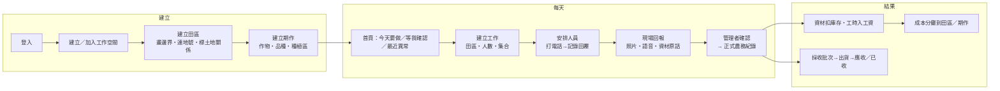

# 農田日記 — 產品簡述（PROJECT_BRIEF）

> 狀態：第一輪架構與計畫（階段 0）。尚未開始正式 Flutter App 或私有後端實作。
> 最後更新：2026-10-20

## 1. 產品理解

「農田日記」是給臺灣家庭農場與小型農業經營者的協作系統。它把「田、人、事、物、錢、證據」串在一起，回答七個日常問題：

| # | 使用者真正想知道的 | 主要資料來源 |
| --- | --- | --- |
| 1 | 這塊田是誰的、誰在用、誰在經營 | 土地關係（land_parcel、land_relation） |
| 2 | 現在種什麼、過去做過什麼 | 期作、種植區、正式農務紀錄 |
| 3 | 花了多少、資材用了多少 | 採購、庫存異動、成本分攤 |
| 4 | 今天要做什麼、誰負責、缺幾個人 | 工作、人員安排 |
| 5 | 田裡有什麼問題、還缺什麼資訊 | 異常、巡田、AI 待確認觀察 |
| 6 | 收成去了哪、錢收到沒 | 採收批次、出貨、應收／已收 |
| 7 | 天氣、災害、人員變動怎麼調整 | 天氣快照、改期影響清單、災害／保險案件 |

貫穿全產品的三條「可信度」規則：

1. **計畫 ≠ 回報 ≠ 正式紀錄**。每筆資料都有明確的確認層級與確認人。
2. **沒有紀錄 ≠ 沒有發生**。缺資料顯示「尚未確認／紀錄不完整」，不推論為「無」。
3. **AI 推測 ≠ 事實**。AI 產出一律是草案或待確認觀察，須人工採納才成為正式紀錄。

## 2. 主要角色與權限雛形

區分五種「人」：登入帳號（user）、工作空間成員（membership）、土地關係人（land party）、工作聯絡人（contact）、外部買方／供應商（counterparty）。一個真人可以同時是其中幾種，但不自動合併。

| 工作空間角色 | 典型人物 | 可做 | 不可做（預設） |
| --- | --- | --- | --- |
| owner 擁有者 | 實際經營者 | 全部，含成員與刪除 | — |
| manager 共同管理者 | 協助父母的子女 | 田區、期作、派工、確認紀錄 | 移除 owner、刪除工作空間 |
| bookkeeper 記帳 | 家人／會計 | 財務、工資、採購 | 修改田界、確認施藥紀錄 |
| worker 現場工作者 | 常駐幫手 | 看自己的工作、回報、拍照 | 看租金、工資表、他人電話 |
| advisor 顧問 | 經授權農改人員 | 唯讀指定田區與紀錄 | 財務、聯絡人個資 |
| viewer 唯讀 | 其他家人 | 唯讀非敏感資料 | 財務、合約、電話 |

臨時工、帶班者原則上是「聯絡人」，不需要 App 帳號。敏感欄位（租金、合約、電話、工資）以「欄位群組權限」控制，由後端過濾，不靠前端隱藏。

## 3. 核心使用者流程

長輩回報的最短路徑（設計目標：3 次點擊內完成）：

1. 首頁「今天要做」點工作卡。
2. 按「我做完了」→ 拍照或按住說話（可略過）。
3. 送出。系統顯示「已存在手機，等待上傳」→「已上傳，等○○確認」。

回報內容保留原始輸入（語音、照片、「一包半」原話），換算與確認由管理者完成。

## 4. 三份清單

### 4.1 已確定

- Flutter 同步開發 Android 與 iOS；Android 原始碼公開於 GitHub 並提供 APK；iOS 目標 App Store。
- 後端原始碼放獨立私有儲存庫；API 優先部署 Cloud Run；大型檔案放 Cloud Storage。
- 優先沿用 Google Cloud／Firebase 生態系，但正式業務資料不預設放 Firestore。
- 後端候選語言 Python（FastAPI）。
- 身分優先沿用 `shenlee377/chat-coffee-bot-python` 分支 `v5-Google-Cloud-Run` 的原生 App OAuth（已讀取，見 [AUTH_INTEGRATION.md](AUTH_INTEGRATION.md)）。
- 三維重建、DJI、LiDAR 皆為可選，不阻塞核心農務。
- 公開 repo 不含秘密與真實個資。

### 4.2 假設（可推翻，推翻時需更新 DECISIONS.md）

| ID | 假設 | 依據／影響 |
| --- | --- | --- |
| A1 | 主要資料庫採 Cloud SQL for PostgreSQL + PostGIS | 見 ARCHITECTURE §2；待你確認 |
| A2 | 單一工作空間初期 ≤ 10 位成員、≤ 50 塊田、≤ 200 位聯絡人 | 影響索引與成本估算，不影響模型 |
| A3 | 田間離線最長約 1 個工作日，之後回到有網路處同步 | 影響本機資料保留與衝突策略 |
| A4 | 第一版地圖用 Google Maps（Flutter `google_maps_flutter`），資料以 WGS84（EPSG:4326）保存，面積以 TWD97 TM2（EPSG:3826）或球面公式計算 | 套件與費率待查證 |
| A5 | 農田日記使用單一 OAuth client 同時給 Android／iOS | 讓 pairwise sub 跨平台一致；見 AUTH_INTEGRATION §4 |
| A6 | 農田日記後端自行簽發 session，不使用 Firebase Authentication | 見 AUTH_INTEGRATION §6 |
| A7 | 推播使用 Firebase Cloud Messaging（FCM），iOS 經 APNs | 需 Firebase 專案；可延到階段 2 |
| A8 | 正式農場位置屬敏感資料，預設不公開分享 | 影響分享與匯出功能 |
| A9 | 雲端區域優先 `asia-east1`（臺灣） | 延遲與資料在地；各服務可用性待查證 |

### 4.3 待驗證

| ID | 項目 | 驗證方式 | 阻塞哪個里程碑 |
| --- | --- | --- | --- |
| V1 | 咖啡廳 OAuth 重構是否已部署、部署在哪個網域 | 你提供部署紀錄或 staging 網址；呼叫 `/.well-known/oauth-authorization-server` | M1-E（正式登入） |
| V2 | 咖啡廳端是否同意新增農田日記 client 及兩項小修改 | 你確認 | M1-E |
| V3 | 咖啡廳 pairwise sub 以 `SECRET_KEY` 計算，金鑰輪替政策 | 讀咖啡廳 secret 管理文件／你確認 | M1-E |
| V4 | 英文名稱、applicationId、Bundle ID、網域 | 你決定；查商標與網域可用性 | M1-D 之前定案 |
| V5 | Flutter 套件：地圖、系統瀏覽器授權、本機 DB、背景上傳的維護狀態與授權 | 開工前逐一查 pub.dev 與原始碼授權 | M1-D |
| V6 | Cloud SQL、Cloud Run、GCS、Cloud Tasks、Maps SDK 當前價目 | 查官方價目頁並記錄查證日期 | 成本預算定案 |
| V7 | 農藥登記、安全採收期等資料的官方來源與授權條款 | 查農業部／防檢署公開資料 | 階段 3 |
| V8 | Cloud Run GPU 在選定區域的可用性與 Job 支援 | 查官方文件 | 階段 5 |
| V9 | 咖啡廳 OAuth 測試在目前分支是否通過 | 在咖啡廳 repo 執行其 pytest | M1-E |

## 5. 高影響澄清問題（最多五個）

1. **公開 repo 內的 `backend/`**：目前 `Farming-Diary` 公開儲存庫已含 FastAPI 後端程式碼，與「後端不公開」衝突。建議：建立私有 repo（暫名 `farming-diary-backend`），把後端移過去，並從公開 repo 刪除該目錄（Git 歷史仍會保留舊版；經檢查其中沒有真實秘密，只有示範用假 token）。是否同意？
2. **資料庫**：是否同意以 Cloud SQL for PostgreSQL + PostGIS 作為唯一正式資料來源？
3. **識別碼**：英文名稱與 ID 要用什麼？候選見 [DECISIONS.md](DECISIONS.md) D-008。你是否擁有可用於 reverse-DNS 與 App Links 的網域？
4. **咖啡廳 OAuth**：v5 重構預計何時部署？是否有 staging 環境？是否同意在咖啡廳 repo 新增 `farming-diary` client，以及兩項小修改（見 AUTH_INTEGRATION §8）？
5. **第一個實際試用農場**：主要作物與規模是什麼（稻、蔬菜、果樹……）？第一版會以它做驗收資料，但模型仍保持作物中立。

## 6. MVP 與研究功能界線

| 類別 | 內容 | 階段 |
| --- | --- | --- |
| **MVP 必要** | 登入、內部使用者、工作空間與角色、田區（邊界版本、地號多對多、土地關係）、期作與種植區、聯絡人、工作與人員安排、現場回報與管理者確認、私有照片、基本權限與稽核 | 1 |
| **MVP 日常** | 行事曆、資材與庫存帳、施用紀錄、出勤與工資、成本、通知、離線同步完善 | 2 |
| **閉環** | 採收、出貨、結算、AI 查詢與草案、異常追蹤、行政／災害／保險案件 | 3 |
| **採集品質** | 裝置能力分級、分塊上傳、雲端品質檢查、補拍任務 | 4 |
| **研究** | 局部三維、地理對齊、實景田界投影、DJI、跨時期視覺比較 | 5 |

判斷原則：沒有它，農場「今天」能不能照常記錄與派工？不能 → MVP；能 → 後續。
